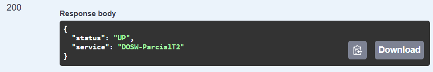
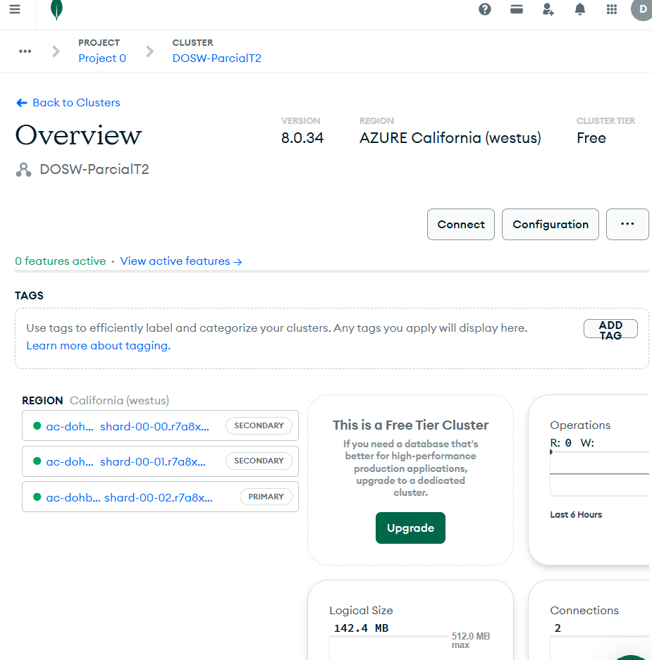
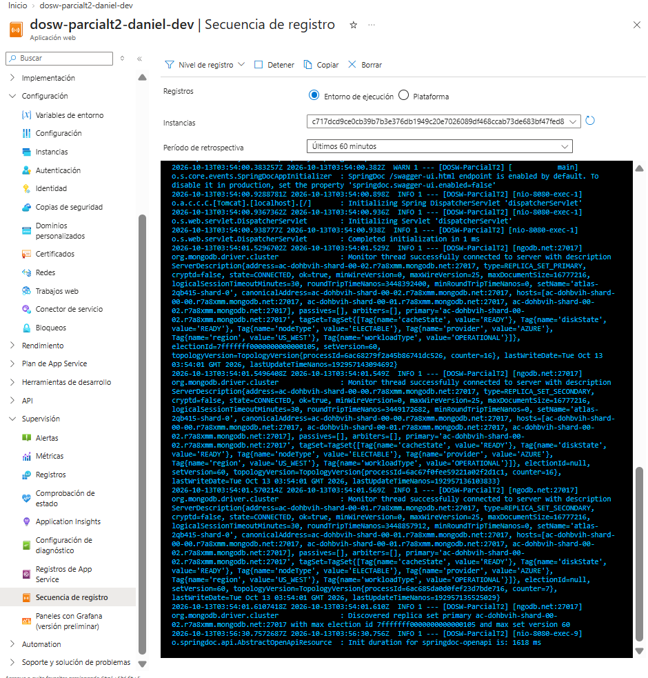
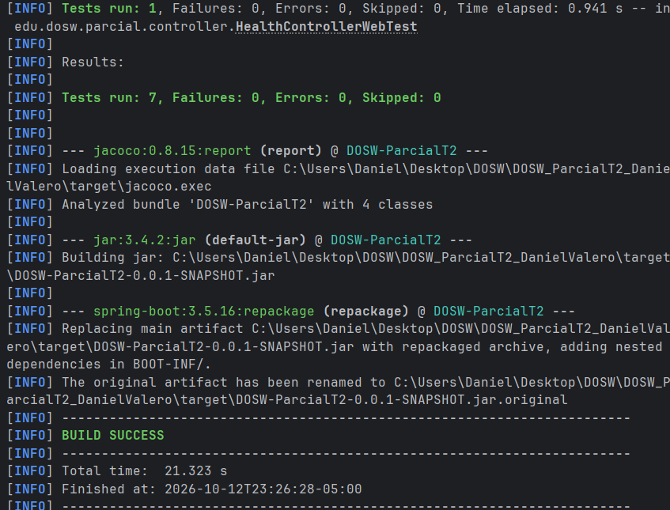
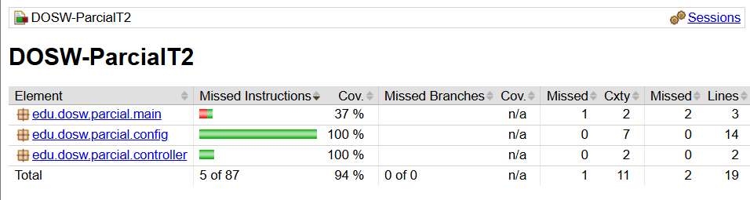
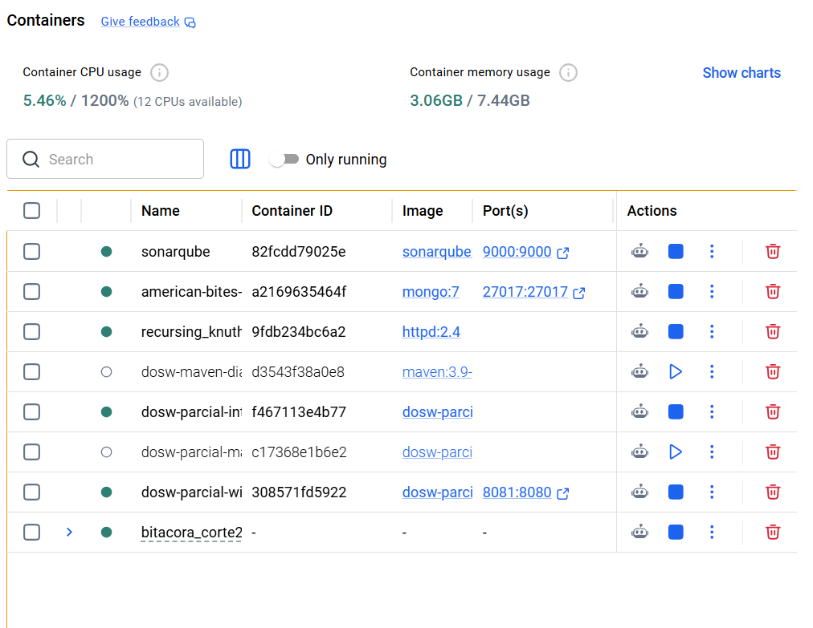
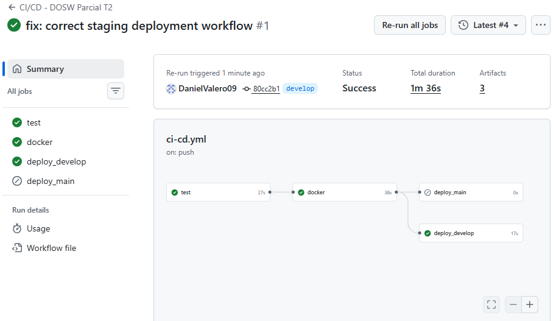
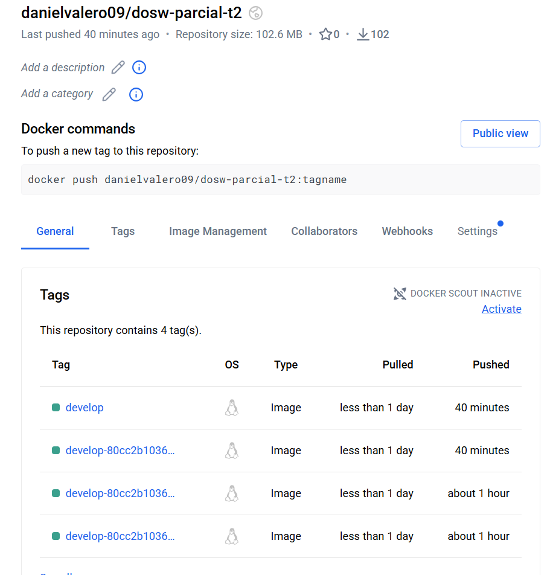
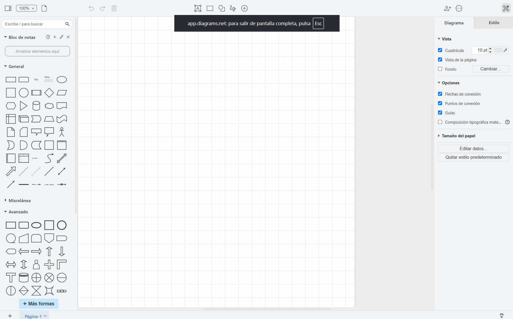

# DOSW_ParcialT2_DanielValero

Proyecto individual para el **Parcial Práctico del Segundo Tercio — DOSW**, basado en **Parte 1.1 · Prerrequisitos**.

> **Estado actual:** proyecto base MVC operativo localmente y desplegado en Azure. Se integraron nueve capturas auténticas revisadas, con sus límites de evidencia. Dos capturas quedan excluidas por datos privados; faltan capturas completas de health y Swagger en Azure. La autenticación JWT completa y la lógica de negocio corresponden al laboratorio posterior. Profesor como colaborador: pendiente.

La [auditoría final](docs/reporte-final-prerrequisitos.md) distingue comprobaciones locales, capturas revisadas, resultados aportados por el estudiante y pendientes. El [inventario de evidencias](docs/images/README.md) registra los archivos reales, sus tamaños y las exclusiones de publicación.

## Índice

1. [Datos del estudiante](#1-datos-del-estudiante)
2. [Descripción del proyecto](#2-descripción-del-proyecto)
3. [Despliegue](#3-despliegue)
4. [Estructura del proyecto](#4-estructura-del-proyecto)
5. [Tecnologías y dependencias](#5-tecnologías-y-dependencias)
6. [Configuración y variables de entorno](#6-configuración-y-variables-de-entorno)
7. [Cómo ejecutar](#7-cómo-ejecutar)
8. [Pruebas](#8-pruebas)
9. [Docker](#9-docker)
10. [CI/CD](#10-cicd)
11. [Herramientas de modelado y diseño (evidencias)](#11-herramientas-de-modelado-y-diseño-evidencias)

## 1. Datos del estudiante

| Campo | Información |
|---|---|
| Nombre completo | Daniel Valero Quiroga |
| Grupo de DOSW | **Grupo 1**, confirmado por el estudiante |
| Institución | Escuela Colombiana de Ingeniería Julio Garavito |
| Trabajo | Individual |
| Profesor como colaborador | **Pendiente de agregar**; no existe confirmación de acceso |
| Repositorio | [DOSW_ParcialT2_DanielValero](https://github.com/DanielValero09/DOSW_ParcialT2_DanielValero) |
| Ramas | `main` y `develop` comprobadas localmente; revisión en `develop` |

## 2. Descripción del proyecto

Servicio REST base desarrollado con Java 21 y Spring Boot, separado en las capas controller, core y persistence.
Prepara el acceso configurable a MongoDB, las dependencias para JWT, Swagger y las herramientas de pruebas y cobertura.
Expone un endpoint público de salud para comprobar que el servicio responde y permitir el despliegue inicial.
La autenticación JWT completa, los roles y la lógica de negocio se implementarán durante el laboratorio posterior.

| Recurso | Ruta | Acceso |
|---|---|---|
| Estado del servicio | `GET /api/v1/health` | Público |
| Swagger UI | `/swagger-ui/index.html` | Público |
| Especificación OpenAPI | `/v3/api-docs` y `/v3/api-docs.yaml` | Público |

Spring Security usa sesiones `STATELESS` y exige autenticación en las demás rutas. Las dependencias JJWT y la configuración `JWT_SECRET` no acreditan un login JWT funcional. El health devuelve un estado fijo del servicio; no consulta MongoDB.

## 3. Despliegue

| Recurso | URL / estado |
|---|---|
| Servicio Azure | [Abrir aplicación](https://dosw-parcialt2-daniel-dev-hge6d7ghd4eab8ar.westus-01.azurewebsites.net) |
| Health público | [GET /api/v1/health](https://dosw-parcialt2-daniel-dev-hge6d7ghd4eab8ar.westus-01.azurewebsites.net/api/v1/health) |
| Swagger público | [Swagger UI](https://dosw-parcialt2-daniel-dev-hge6d7ghd4eab8ar.westus-01.azurewebsites.net/swagger-ui/index.html) |
| Docker Hub | [danielvalero09/dosw-parcial-t2](https://hub.docker.com/r/danielvalero09/dosw-parcial-t2), propietario, alias `develop`, etiqueta única y digest corroborados con su API pública; detalle en la sección 10 |

App Service confirmado: **`dosw-parcialt2-daniel-dev`**, Linux, región **West US**. El estudiante abrió Swagger públicamente y ejecutó el health desde Swagger con **HTTP 200** y respuesta:

```json
{"status":"UP","service":"DOSW-ParcialT2"}
```

### Azure App Service

App Service Linux en West US y publicación por contenedor visibles en la captura revisada. **Imagen excluida de publicación:** `azure-app-service.png` contiene un identificador privado de suscripción. Se conserva localmente; requiere saneamiento y autorización antes de incorporarse.

### Respuesta HTTP 200 y evidencia pendiente de Swagger



La captura muestra código **200** y el JSON esperado. El estudiante la identifica como la respuesta del health en Swagger de Azure, pero el recorte no muestra dominio, endpoint ni interfaz completa. No verifica por sí sola la URL pública ni Swagger cargado. No existe `azure-health-200.png`; quedan pendientes capturas completas con URL y endpoint visibles.

### MongoDB Atlas y conexión de monitoreo



Clúster **DOSW-ParcialT2**, región Azure California (westus), nivel Free y tres nodos visibles: un primario y dos secundarios.



Los registros del App Service muestran conexiones exitosas de **monitoreo del driver** al primario y a dos secundarios. **No acreditan una operación autenticada de lectura o escritura, ni un ping autenticado desde Azure**. El health tampoco consulta MongoDB.

Las capturas documentan el estado observado al recopilarlas; no se realizó un nuevo despliegue ni se repitieron operaciones remotas. El [inventario](docs/images/README.md) detalla el alcance y los pendientes.

## 4. Estructura del proyecto

```text
DOSW_ParcialT2_DanielValero/
├── docs/
│   ├── uml/                         Diagramas fuente (.gitkeep)
│   ├── images/                      Inventario y capturas auténticas revisadas
│   ├── auditoria-primer-commit.md   Antecedente histórico del 10 de octubre
│   └── reporte-final-prerrequisitos.md
├── src/
│   ├── main/
│   │   ├── java/edu/dosw/parcial/
│   │   │   ├── controller/
│   │   │   │   ├── dtos/request/
│   │   │   │   ├── dtos/response/
│   │   │   │   ├── mappers/
│   │   │   │   └── handlers/
│   │   │   ├── core/
│   │   │   │   ├── services/
│   │   │   │   ├── models/
│   │   │   │   ├── validators/
│   │   │   │   └── utils/
│   │   │   ├── persistence/
│   │   │   │   ├── entities/
│   │   │   │   ├── repositories/
│   │   │   │   └── mappers/
│   │   │   ├── config/
│   │   │   └── main/
│   │   └── resources/application.yaml
│   └── test/
│       ├── java/edu/dosw/parcial/
│       │   ├── controller/           Replica DTOs, mappers y handlers
│       │   ├── core/                 Replica services, models, validators y utils
│       │   ├── persistence/          Replica entities, repositories y mappers
│       │   ├── config/
│       │   └── main/
│       └── resources/
├── .github/workflows/ci-cd.yml
├── Dockerfile
├── .dockerignore
├── .gitignore
├── .env.example
├── pom.xml
└── README.md
```

| Paquete | Responsabilidad prevista |
|---|---|
| `controller/` | Recibir HTTP y producir DTOs; contiene el health inicial |
| `controller/dtos/request/` | Entradas de la API |
| `controller/dtos/response/` | Salidas de la API |
| `controller/mappers/` | Mapper IN: DTO ↔ dominio |
| `controller/handlers/` | Tratamiento de excepciones HTTP |
| `core/models/` | Objetos de dominio |
| `core/services/` | Casos de uso |
| `core/validators/` | Reglas de negocio |
| `core/utils/` | Utilidades |
| `persistence/entities/` | Documentos MongoDB futuros con `@Document` |
| `persistence/repositories/` | Interfaces `MongoRepository` futuras |
| `persistence/mappers/` | Mapper OUT: dominio ↔ documento |
| `config/` | Seguridad inicial y OpenAPI |
| `main/` | Arranque con escaneo explícito de `edu.dosw.parcial` y repositorios |
| `src/test/` | Pruebas organizadas por capa |

Las carpetas vacías están conservadas mediante `.gitkeep`. Las responsabilidades de negocio son previstas: no existen todavía entidades, repositorios o mappers de negocio. El Controller no debe depender de documentos de persistencia y el Service no debe depender de DTOs.

## 5. Tecnologías y dependencias

| Tecnología | Versión configurada / referencia | Uso |
|---|---|---|
| Java | 21 | Lenguaje y runtime |
| Spring Boot | 3.5.16 | Aplicación web |
| Spring Web | Administrada por Spring Boot | REST HTTP |
| Spring Data MongoDB | Administrada por Spring Boot | Persistencia documental; sin JPA |
| Spring Validation | Administrada por Spring Boot | Validación de DTOs |
| Spring Security | Administrada por Spring Boot | Seguridad inicial |
| JJWT | 0.13.0 | Dependencias JWT para el laboratorio |
| springdoc | 2.8.16 | OpenAPI y Swagger |
| Lombok | Administrada por Spring Boot | Código repetitivo y soporte de `@Slf4j` |
| MapStruct | 1.6.3 | Generación de mappers |
| lombok-mapstruct-binding | 0.2.0 | Integración de procesadores de anotaciones |
| JUnit 5 y Mockito | Administradas por Spring Boot | Pruebas |
| JaCoCo | 0.8.15 | Cobertura |
| SonarScanner Maven | 5.2.0.4988 | Plugin y propiedades de análisis estático |
| Maven | 3.9.x recomendado | Construcción |
| Docker | Multietapa con Java 21 | Empaquetado |
| GitHub Actions | `ubuntu-latest` | CI/CD |
| Azure App Service | Contenedor Linux, West US | Hosting |
| MongoDB Atlas | Clúster DOSW-ParcialT2 | Base gestionada |

El POM configura los procesadores en el orden Lombok → lombok-mapstruct-binding → MapStruct, los goals JaCoCo `prepare-agent` y `report`, y las propiedades `sonar.*`. La compilación y las pruebas acreditan compatibilidad del proyecto base; esta auditoría no confirma que cada versión sea la estable más reciente ni que se haya ejecutado un análisis SonarQube.

## 6. Configuración y variables de entorno

| Variable | Descripción | Ejemplo sin secretos |
|---|---|---|
| `MONGODB_URI` | URI MongoDB, con valor local predeterminado | `mongodb://localhost:27017/dosw_parcial` |
| `JWT_SECRET` | Clave JWT Base64 de al menos 32 bytes; mínimo 44 caracteres codificados | `REEMPLAZAR` |
| `PORT` | Puerto de escucha Spring | `8080` |
| `WEBSITES_PORT` | Puerto de enrutamiento de App Service | `8080` |

`application.yaml` es el único archivo de configuración de aplicación. Lee MongoDB y JWT del entorno y define `jwt.expiration-ms=3600000`. Spring Boot no carga automáticamente `.env`; establecer las variables en la sesión o en el servicio que ejecuta la aplicación.

Los nombres usados por Actions son `DOCKERHUB_USERNAME`, `DOCKERHUB_TOKEN`, `AZURE_CREDENTIALS` y `AZURE_WEBAPP_NAME_DEVELOP`. Producción usa sus propias `AZURE_CREDENTIALS` y la variable `AZURE_WEBAPP_NAME_MAIN`. El workflow no consume `JWT_SECRET` ni `MONGODB_URI`: las pruebas usan configuración de test y las variables de ejecución se administran en Azure. La ubicación efectiva de secrets y las variables de Azure no se inspeccionó durante esta auditoría.

- `.env.example` contiene únicamente marcadores y una URI local sin credenciales.
- `.gitignore` excluye `.env` reales, certificados, claves, credenciales Azure y `target/`.
- Configurar la URI remota en Azure sin guardar usuario, contraseña o cadena de conexión en Git.
- Publicar solo los nombres de secrets, nunca sus valores o capturas que los expongan.

## 7. Cómo ejecutar

**Requisitos:** Java 21, Maven 3.9+, MongoDB local o remoto; Docker para las opciones con contenedores.

1. Reutilizar MongoDB local si ya está escuchando en 27017. Si el puerto está libre y no existe una instancia, crearla:

   ```bash
   docker run -d --name mongo-parcial -p 27017:27017 mongo:7
   ```

2. En PowerShell, generar una clave temporal y configurar las variables sin imprimir secretos:

   ```powershell
   $jwtBytes = New-Object byte[] 32
   $jwtRandom = [Security.Cryptography.RandomNumberGenerator]::Create()
   try { $jwtRandom.GetBytes($jwtBytes) } finally { $jwtRandom.Dispose() }
   $env:JWT_SECRET = [Convert]::ToBase64String($jwtBytes)
   $env:MONGODB_URI = "mongodb://localhost:27017/dosw_parcial"
   mvn spring-boot:run
   ```

3. Abrir `http://localhost:8080/api/v1/health` y `http://localhost:8080/swagger-ui/index.html`.
4. Para ejecutar la aplicación en Docker, seguir los comandos de la [sección 9](#9-docker), conservando las variables de la sesión.

En Linux/macOS, generar `JWT_SECRET` con `openssl rand -base64 32`, exportar las variables y ejecutar `mvn spring-boot:run`.

## 8. Pruebas

```bash
mvn test
mvn clean verify
```

El primer comando ejecuta las pruebas; el segundo limpia, prueba, genera cobertura y empaqueta. En esta revisión, el **12 de octubre de 2026 a las 23:43:46 -05:00**, `mvn clean verify` terminó con **BUILD SUCCESS**, salida **0**, **7 pruebas, 0 failures, 0 errors y 0 skipped**, con Java **21.0.10**. Tiempo total: **30,329 s**.

| Métrica JaCoCo | Cubierto / total | Resultado |
|---|---|---|
| Líneas | 17/19 | **89,47 %** |
| Instrucciones | 82/87 | 94,25 % |
| Métodos | 10/11 | 90,91 % |
| Clases | 4/4 | 100 % |

Se revisaron los reportes locales `target/site/jacoco/index.html` y `target/site/jacoco/jacoco.xml`, generados por Maven y excluidos de Git. En un clon nuevo deben regenerarse; no se enlazan como archivos disponibles en GitHub. El porcentaje de 94 % mostrado en el resumen HTML corresponde a instrucciones, no a líneas. No hay contador de ramas ni umbral mínimo configurado.

Las siete pruebas comprueban el controlador de salud, su respuesta HTTP pública, Swagger, OpenAPI JSON/YAML, el rechazo de solicitudes anónimas a otras rutas y una sola cadena de seguridad. No ejecutan consultas MongoDB ni validan JWT completo. Los avisos de Mockito/Byte Buddy y Springdoc no produjeron fallos.

### Maven: construcción y pruebas satisfactorias



Terminal real del proyecto: **BUILD SUCCESS**, siete pruebas sin fallos, errores ni omisiones, y empaquetado del JAR. La ejecución capturada duró **21,323 s**, finalizada el **12 de octubre de 2026 a las 23:26:28 -05:00**; es independiente de la validación actual.

### JaCoCo: cobertura del proyecto base



Dos líneas sin cubrir de 19: **17/19 = 89,47 %**. El **94 %** de la columna Cov. corresponde a instrucciones (82/87), no a líneas ni a funcionalidades de negocio.

## 9. Docker

El [Dockerfile](Dockerfile) tiene dos etapas: Maven/Temurin 21 ejecuta `mvn -B clean verify --no-transfer-progress`; la imagen final Temurin 21 JRE copia el JAR y expone el puerto 8080. [.dockerignore](.dockerignore) excluye documentación, generados, entornos y secretos.

```bash
docker build -t dosw-parcial:local .
```

Con `JWT_SECRET` generado en la sesión de PowerShell y MongoDB del host accesible:

```powershell
$env:MONGODB_URI = "mongodb://host.docker.internal:27017/dosw_parcial"
docker run --rm -p 127.0.0.1:8081:8080 -e JWT_SECRET -e MONGODB_URI dosw-parcial:local
```

En Windows/Mac, `host.docker.internal` permite alcanzar MongoDB del host; `localhost` dentro del contenedor identifica al propio contenedor. El puerto 8081 del host debe estar libre. Comprobar `http://localhost:8081/api/v1/health` y `http://localhost:8081/swagger-ui/index.html`.

**Resultados existentes:** construcción y ejecución local satisfactorias, confirmadas por el estudiante. La [auditoría histórica](docs/auditoria-primer-commit.md) registra build con pruebas y un contenedor con health/Swagger HTTP 200. La imagen también fue publicada en Docker Hub mediante Actions. No se reconstruyó, arrancó ni publicó una imagen durante esta auditoría final.

### Contenedor local en Docker Desktop



La captura existe y muestra un contenedor activo con prefijo `dosw-parcial-wi` y puertos **8081:8080**. Nombres e imágenes están truncados y no aparece una respuesta HTTP local: evidencia parcial de ejecución, sin verificar el tag completo, el build ni health. La publicación en Docker Hub se muestra en la sección 10.

La comprobación histórica de ping contra MongoDB local no acredita una operación autenticada contra Atlas desde Azure.

## 10. CI/CD

El [workflow](.github/workflows/ci-cd.yml) se activa con push a `main` o `develop` y permite ejecución manual en esas ramas:

1. `test`: configura Java 21, ejecuta `mvn -B clean verify --no-transfer-progress` y conserva reportes JaCoCo/Surefire como artefactos.
2. `docker`: construye la imagen Linux AMD64 con Buildx, valida los nombres de secrets requeridos, inicia sesión en Docker Hub y publica la imagen construida.
3. `deploy_develop` o `deploy_main`: según la rama, inicia sesión en Azure y despliega la etiqueta única entregada por el job `docker`.

**Ejecución respaldada por captura y API pública en `develop`:** [Actions, run 38341584719](https://github.com/DanielValero09/DOSW_ParcialT2_DanielValero/actions/runs/38341584719). `test`, `docker` y `deploy_develop` exitosos; `deploy_main` omitido correctamente por su condición de rama. La captura muestra el SHA corto **`80cc2b1`**, evento **push**, intento **4** y duración **1 min 36 s**. La API confirma el SHA **`80cc2b1036b5e18819a37b54c3f711c75b6bf651`** y el inicio del intento el **12 de octubre de 2026, 22:49:48 -05:00**. Ese SHA es anterior a la documentación `173b6b8`; no prueba una ejecución sobre el HEAD actual. No se declara probado un despliegue desde `main`.

| Rama | Entorno declarado | Etiquetas publicadas | Destino Azure declarado |
|---|---|---|---|
| `develop` | `staging` | `develop-<SHA>-<run_id>-<run_attempt>` y alias `develop` | Secret `AZURE_WEBAPP_NAME_DEVELOP`; App Service confirmado `dosw-parcialt2-daniel-dev` |
| `main` | `production` | `main-<SHA>-<run_id>-<run_attempt>`, alias `main` y `latest` | Variable `AZURE_WEBAPP_NAME_MAIN`; configuración remota no verificada |

Azure consume la etiqueta única publicada. `develop` no publica `latest`. La separación por ramas y la entrega de la etiqueta son verificables en el workflow; el aislamiento efectivo de permisos y destinos remotos no se inspeccionó. La concurrencia por rama usa `cancel-in-progress: false`.

| Ámbito previsto | Nombres de configuración, sin valores |
|---|---|
| Publicación Docker Hub | Secrets `DOCKERHUB_USERNAME`, `DOCKERHUB_TOKEN` |
| GitHub Environment `staging` | Secrets `AZURE_CREDENTIALS`, `AZURE_WEBAPP_NAME_DEVELOP` |
| GitHub Environment `production` | Secret `AZURE_CREDENTIALS`, variable `AZURE_WEBAPP_NAME_MAIN` |
| Azure, ejecución de la aplicación | `MONGODB_URI`, `JWT_SECRET`, `WEBSITES_PORT` (puerto 8080) |

El pipeline operativo de `develop` reemplaza el estado anterior de preparación pendiente. Su éxito no acredita un ping o lectura autenticada en Atlas. Las pruebas CI no requieren credenciales reales de JWT ni operaciones sobre MongoDB. La configuración y ejecución de producción siguen sin verificarse y no se necesitan para documentar el despliegue de desarrollo.

### GitHub Actions: pipeline exitoso en develop



Estado **Success** para `80cc2b1`; producción aparece omitida. El enlace anterior fue obtenido de la API de GitHub, con coincidencia de SHA, número de ejecución, intento y jobs.

### Docker Hub: imagen publicada



Repositorio **[danielvalero09/dosw-parcial-t2](https://hub.docker.com/r/danielvalero09/dosw-parcial-t2)** con cuatro etiquetas visibles, incluido el alias **`develop`**. Las etiquetas únicas están truncadas en la imagen; la [API pública de etiquetas](https://hub.docker.com/v2/repositories/danielvalero09/dosw-parcial-t2/tags?page_size=10) confirmó Linux AMD64 y estos identificadores del intento 4:

- Imagen: `danielvalero09/dosw-parcial-t2:develop-80cc2b1036b5e18819a37b54c3f711c75b6bf651-38341584719-4`.
- Digest: `sha256:09923bf86f29d7656421d2bbab91f0dee254dc1cf6857b5dd1cf88e27c5ab573`.
- Publicación registrada: **12 de octubre de 2026, 22:50:54 -05:00**. El alias `develop` tenía el mismo digest al consultar.

La etiqueta coincide con SHA, run e intento de Actions. No se inspeccionó el digest del contenedor activo en Azure.

Ver el [inventario](docs/images/README.md) y la [tabla de cumplimiento](docs/reporte-final-prerrequisitos.md#tabla-de-cumplimiento).

## 11. Herramientas de modelado y diseño (evidencias)

### Herramienta UML: Draw.io / diagrams.net



Editor **app.diagrams.net** abierto y disponible. El lienzo está vacío: demuestra acceso a la herramienta, no una cuenta autenticada ni un diagrama UML terminado. `docs/uml/` conserva `.gitkeep`.

### Figma: acceso observado, captura excluida

La captura `figma-cuenta.png` muestra una sesión de Daniel Valero con archivos recientes y FigJam. **No se incorpora:** contiene un correo personal visible. El acceso fue observado, pero su evidencia publicable requiere saneamiento y autorización. No demuestra un prototipo del parcial terminado.

Pendientes del estudiante: agregar al profesor y confirmar su acceso; sanear y autorizar las capturas excluidas; aportar vistas completas de health y Swagger en Azure; ampliar la evidencia Docker local y verificar una operación MongoDB autenticada desde Azure. El grupo ya está registrado como **Grupo 1**. El detalle figura en la [auditoría final](docs/reporte-final-prerrequisitos.md).
